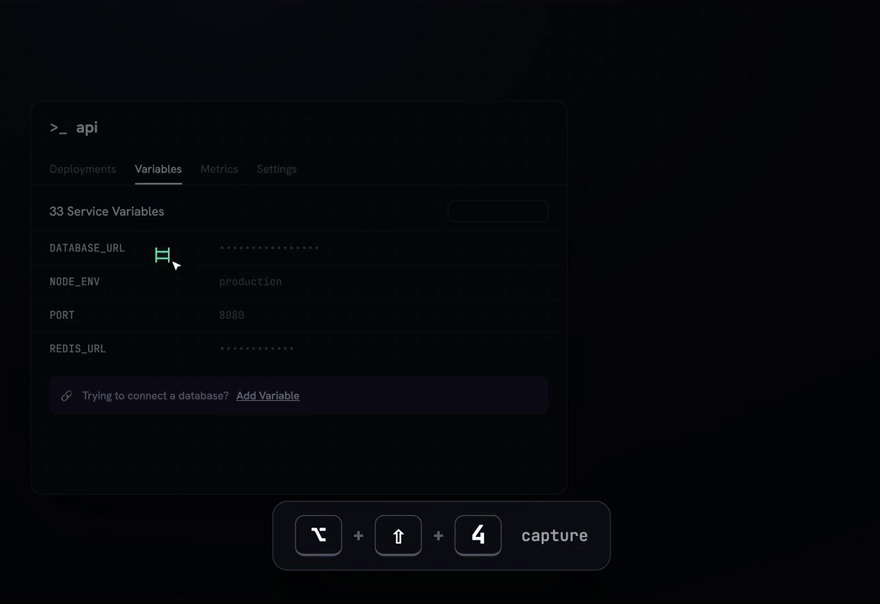

# SnippAI

A native macOS app that collapses *"screenshot → cmd-tab to your terminal → paste the image → type → enter"* into **one step on one screen**, wired directly into a running Claude Code session.



> **Status: shipped.** v1.1.2 is the current release — [download it here](https://github.com/brothaakhee/snippai-releases/releases/latest) ([snippai.dev](https://snippai.dev)). Developer ID signed, notarized DMG, 7-day free trial, then $8.99 once (Lemon Squeezy).
> Requires **macOS 14+** and **iTerm2 or Terminal.app** (Claude Desktop is supported in beta; Warp/Ghostty/kitty aren't supported yet).

**Who it's for:** Mac developers who pair with Claude Code in a terminal and keep needing to show it something on screen — a broken layout, a stack trace in a browser, a design to match.

**Built with:** Swift 6, AppKit + SwiftUI, ScreenCaptureKit for capture, SwiftProtobuf for iTerm2's API, AppleScript for Terminal.app, FluidAudio (on-device Parakeet ASR) for voice input, and Swift Package Manager. The site is static HTML served by Caddy.

---

## What it does

You're working on an app in a Claude Code session. You load it in the browser, spot a UI bug — press **⌥⇧4**, drag a region, type "fix this" in the panel that appears, hit enter. The screenshot + your message land **in the Claude Code session you already have running**, and the response streams back live in the same panel. No file juggling, no alt-tab.

- **Capture we own** — global hotkey (rebindable) → crosshair overlay → ScreenCaptureKit → PNG. The panel opens with pixels already in hand. Multi-display + Retina aware.
- **Session picker** — every live session with rich labels (folder · job · window/tab/pane · last line), agent sessions badged, last-used pinned on top, ⌘-arrows to cycle targets.
- **Live terminal mirror** — the panel renders the session's real emulated screen cells (ANSI colors, cursor and all). It's a second window onto the *same* session — no fork, no second process.
- **Claude Code status** *(opt-in, default-off)* — a fail-open shell hook pipes Stop/Notification events to an in-app AF_UNIX socket, driving a **Done / Needs you** badge in the picker, panel, and menu bar. One-click install/uninstall, never blocks Claude.
- **Send guard** — if the target pane isn't running an agent CLI anymore (Claude exited → you'd be typing into your shell), SnippAI re-checks at send time and asks before sending.
- **Licensing, onboarding, updates** — 7-day trial with a soft paywall, first-run permission checklist (Screen Recording, Automation), launch-at-login toggle, lightweight update check against the latest GitHub release, full uninstall (including hook removal).

## Supported targets

| Adapter | Mechanism | Fidelity |
|---|---|---|
| **iTerm2** | Native Swift client speaking iTerm2's scripting API — AppleScript cookie/key auth → hand-rolled WebSocket (RFC 6455) over its Unix domain socket → SwiftProtobuf from a version-exact `proto/api.proto`. Enumerate / send / stream / focus. | Full: event-driven live mirror with per-cell color |
| **Terminal.app** | AppleScript: discover / send / poll-stream / focus | Plain-text mirror, polled |
| **Claude Desktop** *(beta)* | `claude://` focus → clipboard swap → synthetic ⌘V + Return (CGEvent), with frontmost-app guards and clipboard restore; a transcript-tailing native chat mirror is the display (Electron exposes no terminal screen). Needs the Accessibility grant; briefly focus-steals the Claude window per send. | Transcript mirror; injection is best-effort |

Why the terminal API route: there is **no supported way to inject into a live interactive `claude`** you don't host — no socket/IPC, the Agent SDK can't attach, external transcript edits are ignored, and `--resume` forks a new session. The terminal emulator's own scripting API is the escape hatch; iTerm2's was verified at ~22ms round-trip by a native Swift spike (`swift run iterm-spike`). An early Accessibility probe (`tools/ax_probe.swift`) showed Electron exposes no AX tree for the desktop app, which is why desktop injection uses clipboard+keystroke instead — and why it's labeled beta.

## Permissions & setup

First run walks through a checklist: **Screen Recording** (capture), **Automation → iTerm2/Terminal** (the tunnel), and for iTerm2 a one-time "Enable Python API" toggle (Settings → General → Magic) + Allow dialog. That's the whole onboarding — about 10 seconds.

## Develop

```bash
./scripts/build_app.sh             # release config: assembles + ad-hoc signs build/SnippAI.app
./scripts/build_app.sh debug      # debug config: enables the SNIPPAI_* env hooks (UI screenshots, self-tests)
open build/SnippAI.app             # menu-bar icon appears; press ⌥⇧4 to capture
swift test                         # unit + integration: WS framing, screen parser, hooks (real AF_UNIX), licensing, semver
swift run iterm-spike              # native enumerate/send/stream against a live iTerm — ALL GREEN ~22ms
```

Debug-only env hooks (`SNIPPAI_FAKE_ENTITLEMENT`, `SNIPPAI_AUTO_PANEL`, …) are compiled out of release builds. Releasing (sign → notarize → staple → DMG → appcast) is `scripts/release.sh`; the runbook is [`docs/LAUNCH.md`](./docs/LAUNCH.md).

## Repo contents

| Path | What |
|---|---|
| `Sources/SnippAIKit/` | Engine: iTerm2 native client + protocol, Terminal.app adapter, adapter router, hook bridge, transcript tailer, licensing/version support |
| `Sources/SnippAI/` | Menu-bar app: capture, panel + mirror UI, picker, onboarding, settings, licensing UI, updates, desktop inject |
| `proto/api.proto` | Version-exact iTerm2 API schema (reconstructed by `tools/extract_proto.py`) |
| `site/` | snippai.dev (static, Caddy on Railway) |
| `marketing/` | Marketing plan, launch copy, demo assets |
| `docs/` | Launch runbook, hook-bridge spec, feasibility notes, desktop-inject handoff |
| `scripts/` | `build_app.sh` (dev), `release.sh` (sign/notarize/DMG/appcast) |
| `tools/ax_probe.swift`, `spike_iterm.py` | The original de-risking probes (kept for reference) |

## Roadmap
See [`ROADMAP.md`](ROADMAP.md).

## License
MIT — see [`LICENSE`](LICENSE). Third-party components and their licenses are listed in [`ACKNOWLEDGEMENTS.md`](ACKNOWLEDGEMENTS.md); note that `proto/api.proto` and the Swift generated from it describe iTerm2's API and come from iTerm2 (GPLv2+), not from this project.
